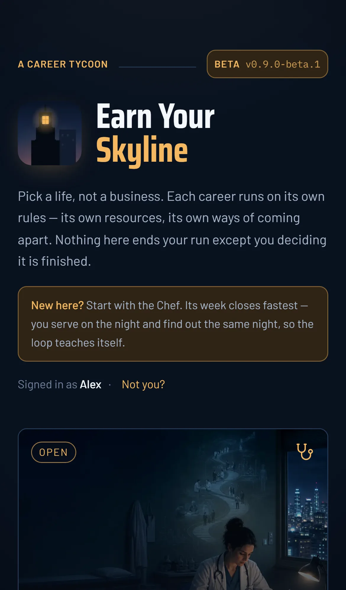
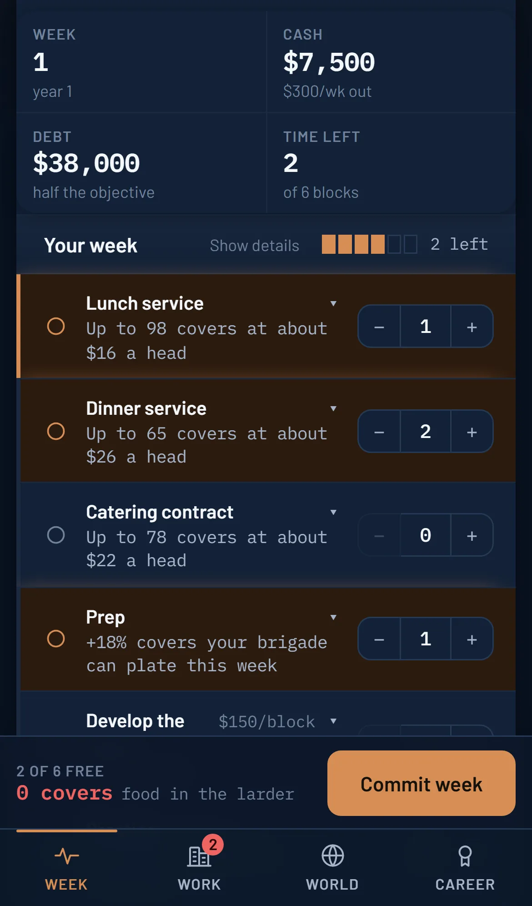
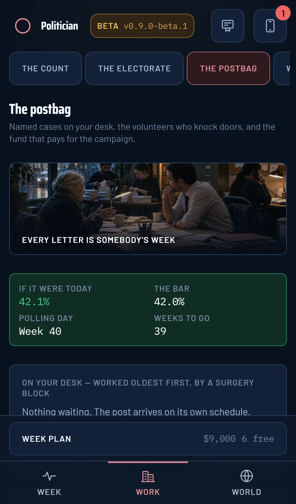
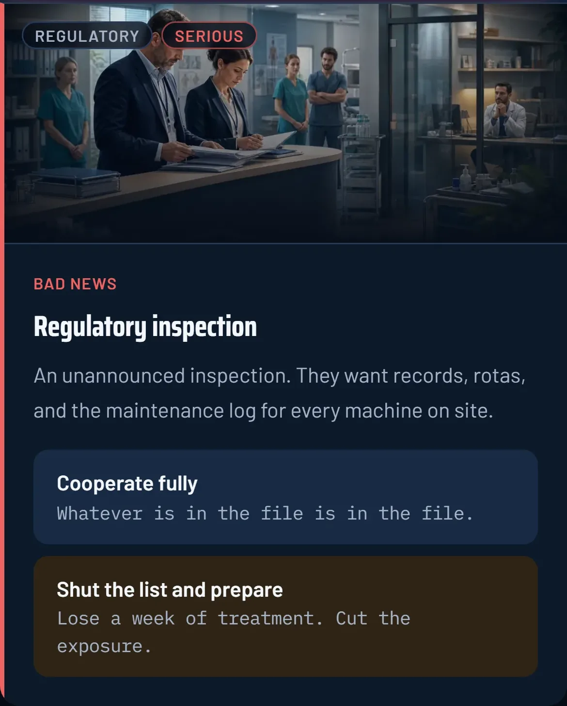
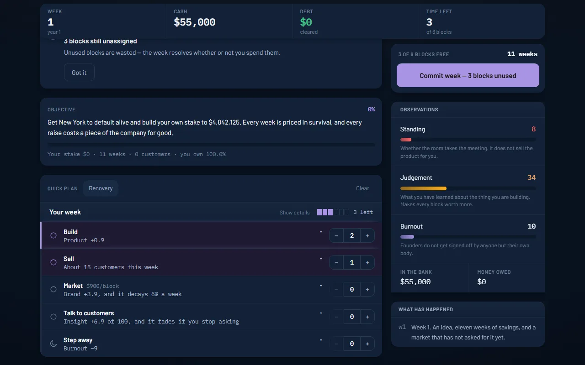

# Earn Your Skyline

<p align="center">
  
</p>

<p align="center">
  <strong>A career sim for your phone. Start with almost nothing, and earn your place in the city one week at a time.</strong><br>
  <em>In beta (v0.9.0-beta.5) · iPhone first, Android later</em>
</p>

## Quick tour

Earn Your Skyline is a game about managing a career one week at a time. Each profession has its own constraints, from ingredient spoilage as a chef to cash runway as a founder. It is built phone-first: on an iPhone, open it in Safari and choose **Add to Home Screen** to install it like an app. The physician path is the most developed and is a good first run.

## Screenshots

<table>
  <tr>
    <td align="center" width="25%">
      <br>
      <sub><b>Pick a life.</b> Seven careers, each with its own way of going wrong.</sub>
    </td>
    <td align="center" width="25%">
      <br>
      <sub><b>Plan the week.</b> Six blocks of time, and every one costs something.</sub>
    </td>
    <td align="center" width="25%">
      <br>
      <sub><b>Every career is its own game.</b> The Politician's postbag and polls.</sub>
    </td>
    <td align="center" width="25%">
      <br>
      <sub><b>Things happen to you.</b> Events arrive with a choice and a cost.</sub>
    </td>
  </tr>
</table>

<p align="center">
  <br>
  <sub>It also runs on a computer: the Founder's week, with the commit button pinned while you plan.</sub>
</p>

The game uses TypeScript, Next.js and React. Start with [simulation logic](lib/game), [interface components](components), or [Playwright tests and fixtures](e2e). See [Verification](docs/DESIGN.md#verification) for command checks and seeded balance simulations.

A turn-based management sim where **each career runs on its own rules**, not a
shared economy with a different skin. Inspired by Business Inc. Tycoon
Simulator, built against the opposite principle: there, every player is a
generic owner optimising the same cash loop. Here, what constrains you depends
on who you are.

Seven careers are playable, and they are not the same game with different
nouns — each is built around a different binding constraint:

| Career | What constrains you | State |
| --- | --- | --- |
| **Physician** | Capability — you cannot treat what you have no department for | The most complete career, and the baseline the others are built against |
| **Chef** | Spoilage — stock decays and is served oldest-first | Playable: recipes, a menu, an ingredient pantry, and a service pipeline worked by a brigade of positions |
| **Solicitor** | The case pipeline — nothing pays until it settles, and it might not | Playable: casework, chambers, staff, counsel, retainers and bill factoring |
| **Founder** | Runway — everything is priced in weeks of survival, and raising more time costs ownership | Playable: product, users, pricing, a team, funding rounds and a market that saturates |
| **Politician** | The electoral cycle — support decays continuously and is only banked on polling day | Playable: a ward, a party, issues, canvassing and elections |
| **Architect** | The long commission — payment is staged against milestones you do not control | Playable: competitions, commissions, a studio and a reputation built in years |
| **Engineer** | Defect risk — everything shipped carries latent faults that surface weeks later | Playable: prototypes, certification, contracts and the liability curve |

A run has **no forced ending**. Failure produces setbacks with recovery routes,
never a game-over screen, and retirement is something you choose.

## How it works

**A week is the turn.** Every week you get six blocks of time. You spend them
on your career's actions (a dinner service, casework, canvassing, a prototype),
see a forecast of what the week will do, then press **Commit week**. The week
resolves:
- money comes in and goes out, line by line
- the career's own model moves: stock spoils, support drifts, runway shrinks
- sometimes an **event** arrives with a choice and a cost

**Each career has one binding constraint** (the table above), and its screens
are built around it. A Chef watches food age, a Politician watches support leak
toward their positions, a Founder counts weeks of runway.

**Between weeks you build.** You take premises, hire, buy equipment, take
positions or raise money. Every purchase states its weekly cost before you
commit to it.

**There is a goal, not an ending.** Each career has an objective, for example
"clear the fit-out loan and build a business worth $2,000,000 in Lyon". Reach
it and retire, and the end screen shows your career's victory scene. Fall
apart and you get a setback with routes back. Retiring is always your choice.

**It is phone-first.** On an iPhone, open the game in Safari and choose **Add
to Home Screen**: it installs with its own icon and opens full screen. It also
runs in any desktop browser.

**Saves stay on your device.** There is no server and no tracking. Profiles
and runs live in the browser's local storage.

## Getting started

```bash
npm install
npm run dev          # http://localhost:3500
```

| Command | What it does |
| --- | --- |
| `npm run dev` | The game at http://localhost:3500 |
| `npm run typecheck` · `npm run lint` | TypeScript and ESLint |
| `npm run check` | About 2,100 engine checks of the game rules |
| `npm run build` | Production build |
| `npm run e2e` | 406 Playwright browser tests, phone and desktop |
| `npx tsx scripts/cities.ts 40 chef` | Balance harness: bots play a career in every city (drop the name for all) |
| `npm run build:art` | Rebuild every game image and icon from the masters in `art-source/` |

**The beta.** Work happens on `feature/…` branches, merges into `beta`, and is
released to `main` through a pull request. Each release is tagged
(`v0.9.0-beta.1` onwards). The current version and a player-facing changelog
are in [`lib/version.ts`](lib/version.ts), shown in the game behind the
**BETA** badge.

## Project layout

| Path | What it holds |
| --- | --- |
| `lib/game/` | The deterministic engine and every career's model (`careers/<career>.ts`), saves and validation |
| `lib/ui/` | What the interface reads: navigation, help text, image registries |
| `components/` | React screens, one `<Career>Screens.tsx` per career |
| `app/` | Next.js app, the iPhone manifest and icons |
| `scripts/` | Engine checks, the balance harness and the art build |
| `e2e/` | Browser tests and saved-game fixtures |
| `art-source/` | Image masters, including the logo (`branding/lit-window-mark.svg`) |
| `public/` | The WebP images and icons the game serves |

## Documentation

| File | For |
| --- | --- |
| [`docs/COMMUNICATION.md`](docs/COMMUNICATION.md) | **Start here if you work on the code.** The rules, the traps and a log of every change |
| [`docs/WORKING_PLAN.md`](docs/WORKING_PLAN.md) | The to-do list and what is done |
| [`docs/DESIGN.md`](docs/DESIGN.md) | The design record: why each career and system works the way it does |
| [`docs/PLAYTEST.md`](docs/PLAYTEST.md) | How to run a session with an outside player, and the notes sheet |
| [`docs/BRAND.md`](docs/BRAND.md) | The brand brief: what the game should feel like |
| [`docs/VISUALS.md`](docs/VISUALS.md) | The art style and the image prompts |
| [`docs/asset-manifest.md`](docs/asset-manifest.md) | Every image and the job it does |

## Where it stands

All seven careers are playable end to end, and a run has no forced ending. The
Physician is the deepest; the other six each run their own model, events and
phone. The honest gaps:

- **No outside player has played it yet.** The tests prove the screens work,
  not that the pacing is fun. [`docs/PLAYTEST.md`](docs/PLAYTEST.md) is the
  kit for the first sessions.
- **Balance is tuned against bots**, which may not play like people. The
  Solicitor and Engineer bots never reach their objective, and the Founder
  reaches it in Berlin only.
- **It has only been tested at iPhone size in Chromium**, not on a real
  iPhone. There is no server, no cloud save and no payments yet.

The full list, career by career, is in
[the design record](docs/DESIGN.md#status).

## License

**All rights reserved.** The code is public so it can be read, but it may not
be copied, modified, published or used without permission. See
[`LICENSE`](LICENSE).

